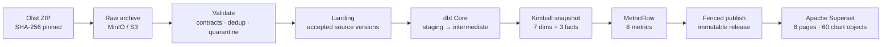
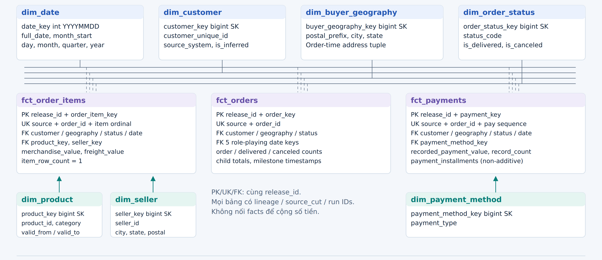
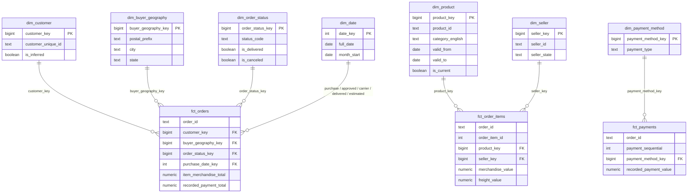
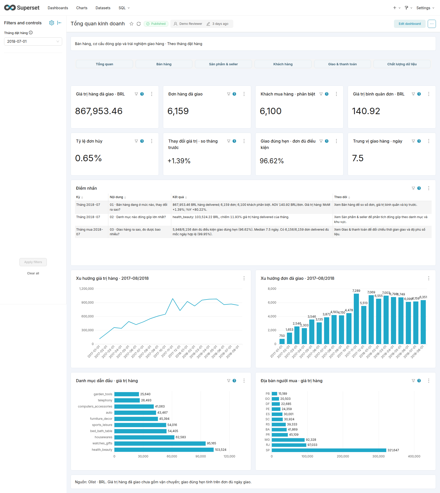
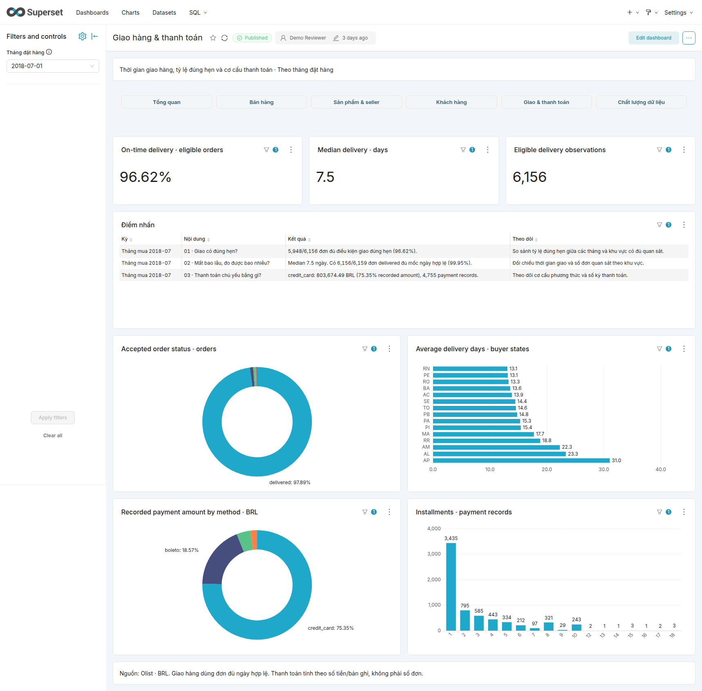
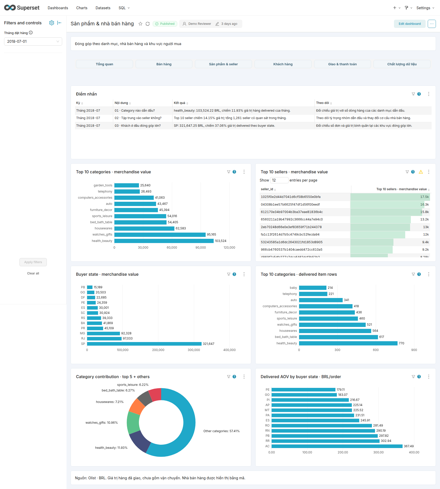
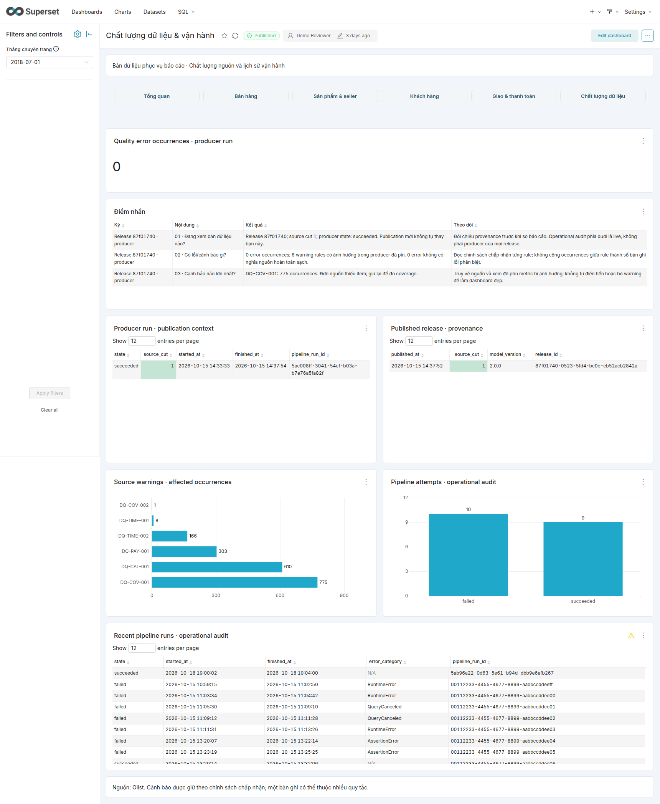

# Olist Sales & Customer Analytics Warehouse


An end-to-end analytics warehouse over the public **Olist Brazilian e-commerce** dataset:
immutable raw archive → PostgreSQL landing → dbt/Kimball → MetricFlow semantic layer → **release-fenced publication** → Apache Superset.

It runs on one machine with Docker Compose, but it is engineered like a small production system:
versioned contracts, blocking quality gates, reconciliation, immutable consumer releases, least-privilege
roles, failure injection and a timed restore drill. Every number in this README is backed by a
machine-generated evidence file in [`docs/evidence/`](docs/evidence/README.md).

> Portfolio project. Independent of, and not a description of, the internal architecture of Abbott or
> Concentrix. The data is Olist's public dataset, used under its own licence.

**Review it in 5 minutes:** [project report (PDF)](output/demo-kit/project-report.pdf) ·
[dashboard screenshots](output/demo-kit/screenshots/overview.png) ·
[runtime evidence](docs/evidence/README.md) · [specification index](specs/spec-package/00-index.md).


*Nine files ship in the Olist archive; the pipeline ingests the seven transactional feeds — reviews and geolocation stay out of scope, see [limits](#status-and-limitations).*

---

## What this repository demonstrates

| Skill area | Concrete implementation |
|---|---|
| ELT pipeline design | 9-stage Airflow DAG (`raw → validate → load → lease → build → snapshot → semantic → publish → finish`), each stage a real CLI process, no data through XCom |
| Dimensional modelling | Kimball: 7 conformed dimensions + 3 facts, warehouse-managed integer surrogate keys, role-playing dates, unknown/inferred members, documented Type 0/1/2 policy |
| Data quality & reconciliation | Blocking admission gates (schema drift, conflicting duplicate keys, equal-revision conflicts), orphan/row-count/money reconciliation, quarantine with issue codes |
| Idempotency & replay | Natural-key + record-hash versioning, `source_cut` checkpoints, replay produces **0 new versions**, late-arriving children recompute the parent |
| Semantic layer | 8 MetricFlow metrics with generated SQL checked against an independent SQL oracle; exports bound to one published release |
| Publication control | Immutable release snapshots, fenced one-owner lease, atomic publish acknowledgement recovery, BI pinned to a release |
| Operations | Retry policy, terminal-failure accounting, health checks, backup/restore drill (102 s), capacity inventory, runbooks |
| Security | Separated DB roles, bootstrap credential not mounted in the worker, loopback-only UIs, per-machine generated secrets, denial tests |
| Engineering process | Versioned spec package, 20 requirement/verification contracts, 28 tests, CI, machine-readable contracts for sources, metrics and releases |

### Honest scope

This is a **demo on a single host**, not a production/HA system. It is PostgreSQL-only; there is no
cloud warehouse target, no source CDC, no external alert receiver and no off-host backup yet. The full,
itemised list is in [implementation progress](docs/implementation-progress.md).

---

## Pipeline



1. **Raw is immutable.** The downloaded archive is checksum-pinned; a changed archive is rejected
   instead of silently overwriting the source of truth.
2. **Admission is a gate, not a log line.** Invalid rows, conflicting duplicates and equal-revision
   conflicts reject the whole batch; diagnostics are preserved and the accepted `source_cut` does not move.
3. **Transformations are tested.** dbt builds staging → dimensions/facts with 75 data tests
   (grain, FK, money reconciliation, source counts) on top of the 18 models.
4. **Publication is atomic and fenced.** A candidate release either becomes the pointed release or
   nothing changes; consumers read one release ID, so a dashboard never mixes versions.

## Data model

Grain is declared before any join; facts are never joined to each other for aggregation.
Metrics combine facts by **drill-across** through conformed dimensions.

**Seven conformed dimensions, three facts.** Every table carries `release_id`; surrogate keys are
warehouse-managed (Unknown = `0`, not-applicable = `-1`), and facts are never joined to each other.

[](docs/assets/warehouse-schema.png)

Prefer another arrangement? Open **[`docs/schema-editor.html`](docs/schema-editor.html)** in a browser:
drag the tables, the key lines follow, then export PNG/SVG or copy the DBML for dbdiagram.io.
The layout is kept in your own browser — nothing to install.

<details>
<summary><b>Editable schema source (Mermaid)</b></summary>



</details>

`fct_orders` is an accumulating snapshot; `fct_order_items` and `fct_payments` are transactions.
`fct_order_items` and `fct_payments` also carry customer/geography/status/date keys (omitted above for
readability). Full ERD: [warehouse ERD](docs/warehouse-erd.md) · [Mermaid source](output/demo-kit/warehouse-schema.mmd) ·
[Kimball design and bus matrix](specs/spec-package/03-data/kimball-design.md).

## Verified results

Recomputed from the published release, not from an ad-hoc query on staging data.

| Metric | Value |
|---|---:|
| Source feeds / rows | 7 feeds / 451,535 rows |
| Orders | 99,441 |
| Order items | 112,650 |
| Payment rows | 103,886 |
| Delivered orders | 96,478 |
| Distinct customers | 96,096 |
| Delivered merchandise value (BRL, excl. freight) | 13,221,498.11 |
| dbt nodes | 93 (18 models + 75 tests) |
| Semantic metrics / exports | 8 / 5, parity-checked |
| Superset pages / chart objects | 6 / 60 |
| Airflow acceptance run | success, ≈264 s |
| Warehouse restore drill | 102.056 s, keys/KPI/ACL verified |

Source-discovered anomalies are documented, not "fixed" silently: 775 orders without items, 1 order
without payment, 610 products without category, 8 delivered orders without a delivery timestamp and
303 orders with a payment delta above 0.01. The quality policy keeps the source truth and blocks
transformation-induced drift instead.

## Data quality

- **Admission gates:** JSON-Schema per feed, natural-key conflict detection, equal-revision conflict
  rejection, artifact checksum re-verified between validate and load.
- **Warehouse tests:** grain uniqueness, FK integrity, money reconciliation (`items − freight = payments`
  within tolerance), source-count reconciliation, quantified duplicate handling.
- **Replay:** re-running a batch creates 0 new source versions and leaves surrogate keys and metrics
  unchanged; a late product master enriches the existing inferred member without changing its key.
- **Failure paths tested for real:** injected stage failure with retry, terminal failure with
  `upstream_failed` downstream, lost publish acknowledgement, two-owner lease race, SCD2 overlap
  rejection on an isolated fixture.
- **Evidence:** [`runtime`](docs/evidence/runtime/manifest.json), [`faults`](docs/evidence/runtime/faults.json),
  [`incremental`](docs/evidence/runtime/incremental.json), [`correction`](docs/evidence/runtime/correction.json),
  [`superset`](docs/evidence/superset/manifest.json).

## Business intelligence

Superset serves an executive overview plus five question-driven pages (sales, product & seller,
customers/cohort, delivery & payment, data quality). Business metrics come from MetricFlow exports;
customer/cohort/delivery analysis uses versioned SQL views with their own oracle. Every card reads the
same published release.

| Overview | Delivery & payments |
|---|---|
|  |  |

| Products & sellers | Data quality |
|---|---|
|  |  |

More: [Superset guide](docs/superset-demo-guide.md) · [business analysis](output/analysis/business-analysis.md) ·
[notebook](output/analysis/analysis.ipynb) · [dashboard question/grain design](docs/analytics-design.md).

## Quickstart

Requirements: Docker Engine + Compose v2, Python 3.12, [uv](https://docs.astral.sh/uv/), ~16 GB RAM,
internet for the first build and the source download.

```bash
# 1. Download the pinned Olist archive (Kaggle credentials required, see below)
export KAGGLE_USERNAME=... KAGGLE_KEY=...
make source

# 2. Full local demo: build images, run controlled migrations, run the pipeline, build BI
make demo

# 3. Verification suites
make test             # 28 tests
make verify-design    # source/fixture/DDL contracts + offline semantic SQL
make verify-runtime   # warehouse, semantics, security and performance checks
make verify-browser   # real dashboard navigation and screenshot checks (Playwright)
```

The Kaggle download endpoint requires authentication. Create a token at
`kaggle.com/settings → API` and export `KAGGLE_USERNAME` / `KAGGLE_KEY`. Without the archive,
`make verify-design` still validates the committed contracts, fixtures and DDL (not the 451,535 source rows).

Services bind to loopback only; credentials are generated per machine under `var/secrets/` and are
git-ignored. There are no default passwords in this repository.

| Interface | URL |
|---|---|
| Superset | http://localhost:18088 |
| Airflow | http://localhost:18080 |
| dbt docs | http://localhost:18081/static_index.html |
| MinIO console | http://localhost:19001 |

Credentials: see [runtime runbook](docs/runtime-runbook.md#đăng-nhập). Nothing is published to
PostgreSQL's host port.

## Repository map

```text
contracts/        Machine-checkable source, model, metric, quality and release contracts
db/               Design DDL, checksummed migrations, role grants
dbt/              Staging, intermediate, dimensions, facts, semantic layer, data tests
orchestration/    Airflow DAG (9 stages, retries, failure accounting)
src/sales_dw/     Pipeline CLI: admission, transform, snapshot, publish, leases, quality
scripts/          Migration entrypoint, verification suites, analysis, packaging
specs/            Versioned specification package (requirements → verification)
docs/             Design, runbooks, evidence and demo kit
tests/            Unit tests and the independently written Kimball golden fixture
output/           Generated reports, dashboard screenshots and the demo kit
```

## Documentation

| Document | Content |
|---|---|
| [Product design](docs/PRODUCTION_DESIGN.md) | Vietnamese product/design narrative |
| [Specification index](specs/spec-package/00-index.md) | Requirements, architecture, data, workflow, verification |
| [Kimball design](specs/spec-package/03-data/kimball-design.md) | Bus matrix, grain, conformed dimensions, SCD policy |
| [Verification matrix](specs/spec-package/06-verification/verification-matrix.md) | 20 requirement/verification contracts |
| [Operating model](specs/spec-package/08-operations/operating-model.md) | SLO targets, backup/restore, retention, alerting design |
| [Runtime runbook](docs/runtime-runbook.md) | Start/stop, credentials, recovery, rotation |
| [Implementation status](docs/implementation-progress.md) | What was actually run, what is not accepted |

## Status and limitations

Verified: the pipeline runs end-to-end on the current host, the dashboard serves the published release,
and restore/failure/replay drills have real evidence files.

Not claimed: production readiness, HA, host-loss RPO, remote CI release governance, clean-room
reproducibility on a second machine, automated retention, external alerting, source CDC or SCD2 history
that the Olist snapshot does not contain. See
[implementation progress → "Chưa nghiệm thu"](docs/implementation-progress.md#chưa-nghiệm-thu--không-được-tuyên-bố).

## Data and licence

Dataset: [Olist Brazilian e-commerce](https://www.kaggle.com/datasets/olistbr/brazilian-ecommerce),
CC BY-NC-SA 4.0 as declared by the publisher. Keep attribution; do not reuse the data commercially.
The code in this repository has no separate licence file; add one before redistributing.

---

## Tóm tắt tiếng Việt

- Dự án portfolio độc lập: ELT từ Olist (7 feed, 451.535 dòng) → MinIO/PostgreSQL → dbt → MetricFlow →
  Superset, điều phối bằng Airflow, chạy local bằng Docker Compose.
- Warehouse Kimball: 7 dimension đồng nhất + 3 fact, 93 dbt node, 8 KPI có đối soát độc lập bằng SQL oracle.
- Chất lượng dữ liệu: chặn batch lỗi ngay cửa vào, quarantine có mã lỗi, đối soát doanh thu/số dòng/Khóa ngoại,
  replay không sinh bản ghi trùng; công bố theo release bất biến nên dashboard không trộn phiên bản.
- Vận hành: retry và ghi nhận lỗi cuối, lease có fencing token, restore DWH 102 giây, role least-privilege,
  secret sinh riêng theo máy và không commit.
- Giới hạn: một máy, không HA, backup local chưa mã hóa, chưa có cảnh báo ra ngoài, chưa có nguồn CDC;
  không đại diện kiến trúc nội bộ Abbott/Concentrix.
