# Bản thiết kế sản phẩm vận hành trên một máy cá nhân

Ngày chốt: 2026-10-15. Phạm vi lượt này: thiết kế/specs, dữ liệu kiểm chứng và kiểm tra thiết kế; triển khai Docker/pipeline ở bước sau theo lựa chọn của người dùng.

## Sản phẩm và người sử dụng

Sales & Customer Analytics Warehouse cung cấp một nguồn số liệu thống nhất cho kinh doanh, phân tích sản phẩm/người bán và vận hành dữ liệu. Nguồn kinh doanh là Olist, không phải hệ thống nội bộ Abbott/Concentrix. Telesales ngoài phạm vi.

Chuẩn doanh nghiệp được áp dụng ở hợp đồng dữ liệu, Kimball modeling, kiểm soát thay đổi, tính đúng, phân quyền, lineage, khả năng chạy lại và khôi phục. Giới hạn vận hành là một host: mất máy/ổ đĩa vẫn là một failure domain. Không tuyên bố có HA hoặc SLA 24/7 của một cụm production.

## Các quyết định đã cố định

| Hạng mục | Quyết định |
|---|---|
| Nguồn dữ liệu | Olist v2, 7 feed nghiệp vụ, snapshot gốc bất biến |
| Ingestion | Python, data contracts, manifest/version ledger, quarantine |
| Raw | S3-compatible local MinIO, source revision và image được khóa |
| DWH | PostgreSQL, Kimball bus architecture, conformed dimensions |
| Transformation | dbt Core, thin staging, intermediate, facts/dimensions, kiểm thử |
| Semantic | dbt semantic models + MetricFlow local, truy vấn thực là điều kiện nghiệm thu |
| Điều phối | Airflow, từng task có trách nhiệm, run/batch/release identity |
| BI | Superset theo ADR-014, chỉ đọc published views; core KPI từ MetricFlow, phân tích mở rộng có SQL/oracle riêng |
| Công bố | Snapshot Warehouse bất biến + metric exports + release pointer |
| Vận hành | Least privilege, secrets, backup/restore, SLO, capacity/retention, runbooks |
| Bàn giao | CI gates, verification matrix, traceability, dossier khi runbook tồn tại |

## Thiết kế Kimball

Đọc [Kimball design](../specs/spec-package/03-data/kimball-design.md).

Ba business process:
1. Bán hàng tại grain một dòng hàng trong đơn — transaction fact.
2. Ghi nhận thanh toán tại grain một payment record trong đơn — transaction fact; không có payment timestamp trong nguồn.
3. Hoàn tất đơn tại grain một đơn — accumulating snapshot fact, chứa các milestone đã quan sát được.

Conformed dimensions: customer, product, seller, buyer geography, date, order status và payment method theo bus matrix. Khóa dimension là warehouse-managed integer surrogate key, không dùng mã nguồn làm PK phân tích. order_id là degenerate dimension trong các fact; không nối trực tiếp các fact để tổng hợp.

Ngày đặt, duyệt, giao cho vận chuyển, nhận hàng và ngày dự kiến dùng chung dim_date dưới các vai trò khác nhau. Dữ liệu thiếu ngày dùng unknown date key; không tạo timestamp giả.

Customer identity sử dụng customer_unique_id. Địa chỉ theo từng đơn đi qua buyer_geography_key, không gán một địa chỉ hiện tại cho toàn bộ lịch sử khách hàng.

Type 0/1/2 chọn theo thuộc tính và dữ liệu có thật. Olist snapshot dùng Type 0/1 thích hợp; khả năng Type 2, interval lookup, late arrival và inferred member được kiểm tra bằng fixture tổng hợp có thời điểm hiệu lực được khai báo rõ.

## Luồng dữ liệu và tính nhất quán

```mermaid
flowchart LR
    A[Olist source + manifest] --> B[Immutable raw]
    B --> C[Validated source versions]
    C --> D[dbt working models at source cut]
    D --> E[Kimball quality gates]
    E --> F[Immutable Warehouse release]
    F --> G[MetricFlow at explicit release]
    G --> H[Metric exports + parity]
    H --> I[Atomic release publication]
    I --> J[Superset / SQL pinned release]
```

Source cut cố định tập phiên bản đầu vào cho toàn bộ model trong một lần build. Bản Warehouse phục vụ consumer và metric exports đều mang release_id. Bản candidate còn dở không nằm trong quyền đọc của BI.

Đây là nâng cấp so với baseline đầu chỉ version hóa metric exports. Consumer facts/dimensions cũng phải được công bố nhất quán. Chi tiết: [production architecture](../specs/spec-package/02-architecture/production-local.md).

## Bộ KPI

Giữ các metric: total_orders, delivered_orders, canceled_orders, cancellation_rate, delivered_merchandise_value, delivered_aov, delivered_unique_customers, delivered_item_rows.

- Tiền dùng numeric/Decimal; không cộng float.
- BRL là quy ước hợp đồng demo vì CSV không có currency.
- Giá trị hàng không phải net revenue hay phí doanh thu của Olist.
- Distinct khách hàng phải tính tại đúng kỳ/nhóm; AOV là ratio của tổng.
- Dimension được phép khác nhau theo metric. AOV cấp sản phẩm chưa có trong hợp đồng.
- Ngày bán là purchase date; trạng thái là snapshot được chấp nhận. Không gọi đó là trạng thái đã biết tại ngày mua.

## Dữ liệu và bằng chứng

- ZIP nguồn đã tải, checksum và source profile có thật.
- Golden fixture được tách namespace synthetic_contract_fixture; kết quả kỳ vọng được ghi độc lập.
- Offline semantic probe kiểm tra syntax, semantic joins và SQL generation.
- Kimball fixture verifier kiểm tra grain, additivity, non-additive metrics, role dates, Type 2 intervals và late arrival.
- Các kết quả trên không thay thế real-run PostgreSQL, Airflow, object storage hay Metabase.

## Vận hành và nghiệm thu

[Operating model](../specs/spec-package/08-operations/operating-model.md) quy định SLO mục tiêu, RPO/RTO, ownership, runbooks, backup/restore, credential rotation và capacity.

[Verification matrix](../specs/spec-package/06-verification/verification-matrix.md) và [test strategy](../specs/spec-package/06-verification/test-strategy.md) phân biệt:
- Kiểm tra thiết kế/data fixture có thể chạy ngay.
- Gate hệ thống chỉ được đánh dấu pass sau khi triển khai và thực thi trên storage/database thật.

Không đưa make target chưa tồn tại vào executable dossier. Không gọi dự án production-ready trước khi startup, quality, semantic execution, BI, replay, recovery, security và restore đều có evidence.

## Đường đi triển khai

1. Review và freeze contracts/Kimball model.
2. Provision môi trường cô lập, migration, roles/secrets và health checks.
3. Một lát cắt source -> fact -> semantic -> published output chạy thật.
4. Mở rộng đủ 7 feed và các kỳ dữ liệu.
5. Kiểm tra replay, correction, failure injection và rollback.
6. Kiểm tra backup/restore, performance, retention và đóng gói demo.

Không đưa cam kết bốn ngày hoặc tỷ lệ tăng tốc chưa đo. Ngân sách đĩa cứng tối đa 70 GB; mục tiêu khởi đầu 20–30 GB gồm images, caches, volumes, WAL, releases, backups và logs.

