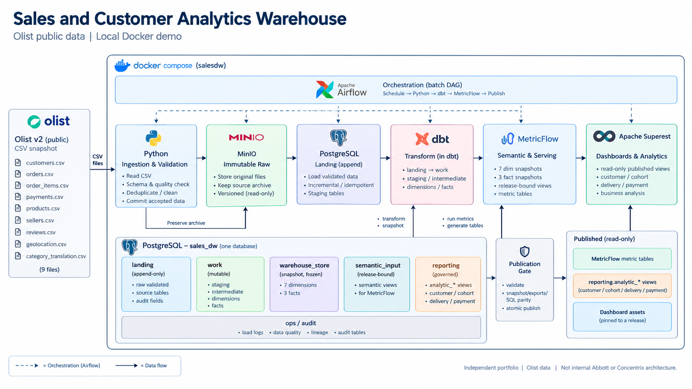

# Sales and Customer Analytics Warehouse

**Báo cáo demo Data Engineer · $date**

### Mục tiêu

Xây dựng nguồn phân tích thống nhất cho bán hàng, khách hàng, sản phẩm và giao hàng; thể hiện ingestion, Kimball/dbt, semantic KPI, data quality và báo cáo Superset.

### Nguồn dữ liệu

Dùng [Brazilian E-Commerce Public Dataset by Olist](https://www.kaggle.com/datasets/olistbr/brazilian-ecommerce), version 2. Đây là dữ liệu thương mại điện tử lịch sử, không phải dữ liệu Abbott. Archive nguồn có 9 CSV; phiên bản demo xử lý **7 feed với 451.535 dòng**. Reviews và geolocation chưa nằm trong phạm vi nạp.

| Dữ liệu | Số dòng | Nội dung |
|---|---|---|
| Customers | 99.441 | Tham chiếu khách và địa chỉ theo đơn |
| Orders | 99.441 | Đơn hàng, trạng thái và mốc thời gian |
| Order items | 112.650 | Dòng hàng, giá, phí vận chuyển, sản phẩm, seller |
| Payments | 103.886 | Payment record, phương thức và số kỳ thanh toán |
| Products | 32.951 | Mã sản phẩm và thuộc tính danh mục |
| Sellers | 3.095 | Mã người bán và địa lý |
| Category translation | 71 | Tên category được chuẩn hóa sang tiếng Anh |

Giữ archive bất biến, manifest và checksum để truy vết. Nguồn là snapshot; bản demo không có database OLTP riêng hoặc CDC.

### Đầu ra

- Warehouse gồm **7 dimensions, 3 facts**, có grain, khóa và quan hệ rõ ràng.
- **8 KPI lõi, 5 MetricFlow exports**, cùng SQL phân tích khách hàng, giao hàng và thanh toán.
- **6 dashboard Superset**, có bộ lọc, điều hướng và nhận xét dựa trên truy vấn.
- Bằng chứng về data quality, retry, chạy lại an toàn và khôi phục DWH.

Portfolio Docker local, telesales ngoài v1; không phải hệ thống nội bộ Abbott/Concentrix hoặc production. License dữ liệu theo metadata nguồn: Olist CC BY-NC-SA 4.0.

<!-- pagebreak landscape -->

## 1 Kiến trúc hệ thống

Phạm vi triển khai: v1 nạp 7/9 CSV, không nạp reviews/geolocation. Dimensions/facts nằm ở `warehouse_store` trong PostgreSQL; MetricFlow đọc chúng để tính KPI. Superset chỉ đọc dữ liệu đã công bố; cập nhật dashboard assets là bước riêng với pipeline.

<!-- pagebreak landscape -->

## 2 Mô hình Warehouse Kimball

Grain: orders theo đơn, items theo dòng hàng, payments theo payment record; luôn có source namespace. Các star dùng chung conformed dimensions và integer dimension SK. PK/FK cùng `release_id`; tổng hợp từng fact trước khi drill-across, không join atomic facts để cộng tiền. Các đường routing chung chỉ phục vụ bố cục hình.

<!-- pagebreak portrait -->

## 3 Quy trình và độ tin cậy dữ liệu

### Pipeline do Airflow điều phối

`raw → validate → load → lease → build → snapshot → semantic → publish → finish`

Python giữ raw và kiểm tra schema trước khi nạp accepted versions. dbt chuẩn hóa, xây dimensions/facts và chạy tests. Hệ thống đóng băng snapshot, chạy MetricFlow và đối soát SQL trước khi công bố. DAG chạy theo lịch 02:00 Asia/Ho_Chi_Minh, có retry và task logs.

Nguồn Olist tĩnh không tự phát sinh giao dịch mới. Bản live dùng full-v2 ở source cut 1; incremental, dữ liệu đến muộn và correction đã được kiểm riêng trong môi trường cô lập, có đánh dấu mô phỏng về cách giao dữ liệu.

### Kiểm soát chất lượng và cách phục vụ BI

| Kiểm soát | Cách xử lý |
|---|---|
| Schema, khóa, grain và quan hệ | Phát hiện sai định dạng, khóa trùng, quan hệ thiếu hoặc phép nối làm nhân số liệu |
| Cảnh báo có sẵn từ nguồn | Giữ dữ liệu và flags; không bịa tiền hoặc xóa order để làm sạch báo cáo |
| Semantic và tiền | MetricFlow đối chiếu SQL oracle; tiền dùng numeric/Decimal |
| Publication | Candidate lỗi không thay bản đã công bố; chart cùng pin một release |

MetricFlow định nghĩa và thực thi 8 KPI lõi, rồi lưu 5 bảng kết quả trong `reporting`. Các phân tích cohort, giao hàng và payment dùng governed SQL views trên published Kimball. Đây là lớp phục vụ trong cùng PostgreSQL, không phải DWH thứ hai. AOV/tỷ lệ được tính lại từ tử và mẫu; distinct khách hàng không cộng dồn theo ngày.

### Bằng chứng đã có

| Hạng mục | Kết quả kiểm chứng |
|---|---|
| dbt và Warehouse | 18 models + 75 tests; 10 snapshot relations có kiểm grain, FK và số liệu |
| Superset | 60 đối tượng báo cáo, 8 SQL Lab queries; 6 trang render và 14 lượt điều hướng thật |
| Chạy lại và recovery | Replay không thêm source versions; task lỗi không publish; retry và late-arrival có evidence riêng |
| DWH restore | Restore vào database mới trong $restore giây; không ghi đè live |

Phạm vi kiểm chứng: runtime DE/restore ngày 15/10/2026; UI được kiểm lại trong lần khởi động $health_date. Đây là kết quả tại máy demo, không phải nghiệm thu production.

<!-- pagebreak portrait -->

## 4 Kết quả và cách demo

### Kết quả tháng $month

| Chỉ số | Kết quả | Định nghĩa ngắn |
|---|---|---|
| Giá trị hàng delivered | $value BRL | Chưa gồm phí vận chuyển |
| Đơn delivered | $orders | Theo trạng thái nguồn đã chấp nhận |
| Khách mua delivered | $customers | Distinct khách trong tháng |
| Delivered AOV | $aov BRL/đơn | Giá trị hàng / số đơn delivered |
| Hủy đơn | $cancel% | 41 canceled / 6.292 total orders |
| Biến động giá trị | +$mom% MoM | So với đúng tháng trước |
| Giao đúng hẹn | $ontime% | 5.948 / 6.156 đơn đủ mốc ngày |

### Bộ dashboard

| Trang | Câu hỏi được trả lời |
|---|---|
| Tổng quan kinh doanh | Kinh doanh thế nào và nên xem sâu ở đâu? |
| Hiệu quả bán hàng | Giá trị, số đơn, khách và AOV thay đổi ra sao? |
| Sản phẩm và seller | Category, seller, khu vực nào đóng góp lớn? |
| Khách hàng và mua lại | Repeat, recency và cohort trong cửa sổ quan sát thế nào? |
| Giao hàng và thanh toán | Giao đúng hẹn, thời gian giao và payment mix ra sao? |
| Chất lượng và vận hành | Dữ liệu đến từ release nào; có cảnh báo và run lỗi gì? |

Ví dụ phân tích: `health_beauty` dẫn đầu tháng với 11,93% giá trị hàng delivered; top 10 seller đóng góp 14,15%. Đến cutoff 31/08/2018, 2.801/93.358 khách có mua lại, tương đương 3,00%; không gọi khách một đơn là churn.

Demo: mở [Tổng quan Superset](http://localhost:18088/superset/dashboard/olist-overview-87f01740/), đổi tháng 07 sang 06, xem KPI/nhận xét đổi và chuyển sang trang chuyên sâu. Menu giữ tháng/release; customer/cohort luôn giữ cutoff riêng. Ảnh sáu dashboard thật và phân tích SQL/notebook nằm trong bộ demo đi kèm.

Giới hạn: dữ liệu lịch sử, BRL là quy ước demo; không có cost, target hoặc profit để kết luận vượt kế hoạch hay lợi nhuận. Single-host local, chưa có HA/off-host recovery và không tuyên bố production-ready. Release trình bày: `87f01740`.
