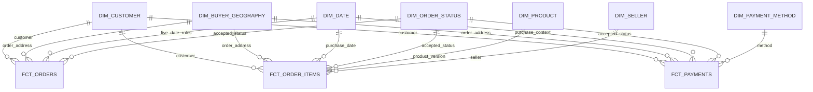

# Kimball Warehouse constellation

Logical ERD. Dimension relationships are shared across processes; order_id is retained as a degenerate dimension. There are no fact-to-fact reporting relationships.

Every consumer relation is scoped by release_id; physical fact FKs reference (release_id, dimension_key). fct_orders is an accumulating snapshot of one order; item/payment facts retain their independent transaction grains.

Detailed bus matrix, change policies and measures: [Kimball design](../specs/spec-package/03-data/kimball-design.md).
